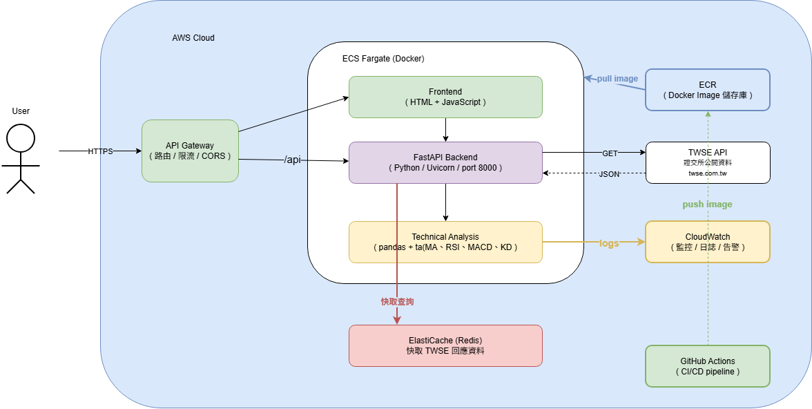

# 台股技術分析 API

串接台灣證券交易所（TWSE）公開資料，提供個股技術指標分析的 RESTful API。

## 功能

- 輸入股票代號，自動抓取近半年歷史資料
- 計算技術指標：MA5、MA20、RSI、MACD、KD
- 提供 RESTful API，支援 Swagger UI 互動式文件

## 技術

- **語言**：Python 3.12
- **框架**：FastAPI
- **資料來源**：TWSE 證交所公開 API
- **分析套件**：pandas、ta (Technical Analysis)
- **容器化**：Docker

## 安裝與執行

### 方法一：本地執行

```bash
# 1. 建立虛擬環境
python -m venv .venv

# 2. 啟動虛擬環境
# Windows:
.venv\Scripts\activate
# Mac/Linux:
source .venv/bin/activate

# 3. 安裝套件
pip install -r requirements.txt

# 4. 啟動 API
uvicorn stock_analysis:app --reload
```

### 方法二：Docker 執行

```bash
docker build -t stock-api .
docker run -p 8000:8000 stock-api
```

啟動後開啟 http://localhost:8000/docs 查看 API 文件。

## API 使用範例

### 取得個股技術分析

```
GET /stock/analysis/{stock_no}
```

範例：查詢台積電（2330）

```bash
curl http://localhost:8000/stock/analysis/2330
```

回傳：

```json
{
  "股票代號": "2330",
  "收盤價": 1050.0,
  "MA5": 1048.6,
  "MA20": 1035.25,
  "RSI": 62.35,
  "MACD": 5.12,
  "Signal": 3.88,
  "K": 72.15,
  "D": 68.42,
  "成交量": 25000000
}
```

## 雲端架構圖


